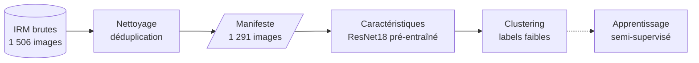

<a id="readme-top"></a>

<!-- PROJECT LOGO -->
<br />
<div align="center">

<h3 align="center">BrainScanAI - IRM cérébrales semi-supervisées</h3>

  <p align="center">
    Exploration et détection semi-supervisée de tumeurs cérébrales à partir d'IRM partiellement annotées : préparation des données, extraction de caractéristiques visuelles, regroupements naturels, puis comparaison d'une approche supervisée et d'une approche semi-supervisée.
    <br />
    <a href="https://lefevrk.github.io/OC-Appliquez-des-approches-semi-supervisees/"><strong>Explorer la doc »</strong></a>
    <br />
    <br />
    <a href="https://github.com/lefevrk/OC-Appliquez-des-approches-semi-supervisees/issues/new?labels=bug&template=bug_report.md">Signaler un bug</a>
    &middot;
    <a href="https://github.com/lefevrk/OC-Appliquez-des-approches-semi-supervisees/issues/new?labels=enhancement&template=feature_request.md">Proposer une fonctionnalité</a>
  </p>

  [](https://github.com/lefevrk/OC-Appliquez-des-approches-semi-supervisees/actions/workflows/docs.yml)
</div>

<!-- TABLE OF CONTENTS -->
<details>
  <summary>Sommaire</summary>
  <ol>
    <li>
      <a href="#à-propos-du-projet">À propos du projet</a>
      <ul>
        <li><a href="#contexte">Contexte</a></li>
        <li><a href="#fonctionnalités">Fonctionnalités</a></li>
        <li><a href="#technologies-utilisées">Technologies utilisées</a></li>
        <li><a href="#feuille-de-route">Feuille de route</a></li>
      </ul>
    </li>
    <li>
      <a href="#démarrage">Démarrage</a>
      <ul>
        <li><a href="#prérequis">Prérequis</a></li>
        <li><a href="#installation">Installation</a></li>
      </ul>
    </li>
    <li><a href="#utilisation">Utilisation</a></li>
    <li><a href="#organisation-du-projet">Organisation du projet</a></li>
    <li><a href="#résultats-clés">Résultats clés</a></li>
    <li><a href="#remerciements">Remerciements</a></li>
  </ol>
</details>

<!-- ABOUT THE PROJECT -->
## À propos du projet

Ce dépôt est la première phase du projet fictif *BrainScanAI* de la startup e-santé *CurelyticsIA* : explorer la possibilité d'automatiser la détection de tumeurs du cerveau à partir d'un grand nombre d'IRM, dont **seules 100 sur 1 506 sont annotées** par des radiologues experts.



La flèche pointillée est l'étape à venir.

### Contexte

Annoter une IRM demande l'avis d'un radiologue : c'est long et coûteux. Une approche semi-supervisée tire parti des nombreuses images non annotées pour compléter le faible signal des quelques labels disponibles. Le projet compare ainsi un modèle entraîné sur les seules images annotées à un modèle qui exploite aussi les images non annotées, puis formule des recommandations pour un passage à l'échelle.

### Fonctionnalités

- **Inventorie** les images brutes dans une table unique (identifiant, sous-ensemble, label, taille), sans jamais modifier `data/raw/`
- **Contrôle** la lisibilité, le format, les dimensions et le mode couleur de chaque image
- **Détecte les doublons exacts** (empreinte SHA-256) et les **quasi-doublons**, retournés ou pivotés compris (miniatures comparées dans les 8 orientations), pour éviter toute fuite entre apprentissage et évaluation
- **Applique une règle de déduplication** reproductible : la copie annotée est conservée en priorité, et **exclut** les images inexploitables
- **Produit un manifeste CSV** aux chemins relatifs, et un **rapport des suppressions** qui justifie chaque image retirée
- **Mesure la qualité du contenu** des images (luminosité, contraste, netteté, part de fond, couleur) et repère celles qui pourraient fausser la suite
- **Réduit les biais liés à l'image** par un prétraitement en niveaux de gris avec égalisation d'histogramme, dont l'effet est mesuré
- **Extrait des caractéristiques visuelles** avec un ResNet18 pré-entraîné et gelé (couches `layer3` et `layer4`), enregistrées avec leurs identifiants dans des fichiers `.npz`
- **Visualise où le réseau regarde** : cartes d'activation et Grad-CAM, puis cartes directionnelles qui montrent ce qui distingue les deux groupes de K-Means
- **Réserve un jeu de test et un jeu de validation** avant toute transformation, tirés parmi les images annotées de façon stratifiée
- **Regroupe les images** (K-Means, DBSCAN) après standardisation et PCA, mesure l'accord avec les labels forts (ARI), balaie le nombre de clusters et attribue des **labels faibles** aux images non annotées avec K-Means
- **Suit les expériences** avec MLflow, en local : un run par configuration testée, avec ses paramètres, ses métriques, ses figures et ses modèles
- **Se teste et se documente** : tests `pytest` sur la préparation, l'extraction, les labels faibles et l'absence de chemin personnel dans les notebooks, documentation MkDocs avec référence d'API générée

### Technologies utilisées

<ul>
  <li> <strong>Python 3.12</strong> - langage principal</li>
  <li> <strong>pandas</strong> - tables de données et manifeste</li>
  <li> <strong>NumPy</strong> - calcul sur les images</li>
  <li> <strong>scikit-learn</strong> - PCA, clustering et plus proches voisins</li>
  <li> <strong>Matplotlib</strong> - visualisations</li>
  <li> <strong>Jupyter</strong> - notebooks d'analyse</li>
  <li> <strong>PyTorch & torchvision</strong> - ResNet18 pré-entraîné, extraction des features et cartes d'attention</li>
  <li> <strong>OpenCV</strong> - netteté des images</li>
  <li><strong>MLflow</strong> - suivi des expériences en local</li>
  <li> <strong>pytest</strong> - tests</li>
</ul>

### Feuille de route

| Étape de la mission | État |
|---|---|
| 1. Importer les données et explorer le jeu de radiographies | Terminée |
| 2. Prétraiter et extraire les caractéristiques | Terminée |
| 3. Réaliser une analyse non supervisée | Terminée |
| 4. Appliquer une méthode semi-supervisée | À venir |
| Synthèse et recommandations de passage à l'échelle | À venir |

<p align="right">(<a href="#readme-top">retour en haut</a>)</p>

<!-- GETTING STARTED -->
## Démarrage

### Prérequis

- [Python 3.12+](https://www.python.org/downloads/)
- [uv](https://docs.astral.sh/uv/getting-started/installation/) pour gérer les dépendances
- Le jeu de données d'IRM, à placer dans `data/raw/` (le dossier `data/` n'est pas versionné) :

  ```text
  data/raw/
  ├── sans_label/             # IRM sans annotation
  └── avec_labels/
      ├── cancer/             # IRM annotées « cancer »
      └── normal/             # IRM annotées « normal »
  ```

### Installation

1. Cloner le dépôt
   ```bash
   git clone https://github.com/lefevrk/OC-Appliquez-des-approches-semi-supervisees.git
   cd OC-Appliquez-des-approches-semi-supervisees
   ```

2. Installer les dépendances
   ```bash
   uv sync
   ```

<p align="right">(<a href="#readme-top">retour en haut</a>)</p>

<!-- USAGE EXAMPLES -->
## Utilisation

Détail complet dans la [documentation](docs/docs/getting-started.md).

### Produire le jeu dédupliqué

```bash
make data
```

La commande écrit `data/interim/manifest.csv` (images conservées), `reports/removed_duplicates.csv` (images retirées, avec la raison) et `data/processed/split.csv` (jeu d'entraînement, de validation ou de test de chaque image). Ses options se listent avec `uv run python -m brain_mri.dataset --help`.

### Relire le manifeste

```python
from brain_mri.config import INTERIM_DATA_DIR
from brain_mri.dataset import read_manifest

manifest = read_manifest(INTERIM_DATA_DIR / "manifest.csv")
labeled = manifest.query("is_labeled")
```

### Extraire les features

```bash
make features
```

La commande lit le manifeste et écrit, dans `data/processed/`, `features_resnet18_layer3.npz` et `features_resnet18_layer4.npz` (identifiants et matrice de features). Les poids du ResNet18 sont téléchargés au premier lancement.

### Calculer les labels faibles

```bash
make unsupervised
```

La commande ajuste la standardisation, la PCA et K-Means sur le jeu d'entraînement et écrit, dans `data/processed/`, `weak_labels.csv` : un label faible (`cancer` ou `normal`) et une confiance pour chaque image non annotée. Elle suppose que `make data` et `make features` ont été lancés.

### Reproduire les analyses

| Notebook | Contenu |
|---|---|
| `notebooks/01.01-kl-data-exploration.ipynb` | Exploration initiale du jeu de données |
| `notebooks/01.02-kl-image-quality.ipynb` | Qualité du contenu des images |
| `notebooks/02.01-kl-data-cleaning.ipynb` | Doublons exacts et quasi-doublons sur 8 orientations, règle de déduplication |
| `notebooks/02.02-kl-feature-extraction.ipynb` | Prétraitement, extraction des features et cartes d'attention |
| `notebooks/03.01-kl-unsupervised-analysis.ipynb` | Découpage, réduction de dimension, clustering, labels faibles et cartes directionnelles |

Les clusterings de `03.01` sont enregistrés dans MLflow : `make mlflow-ui` ouvre l'interface.

### Consulter la documentation

```bash
uv run mkdocs serve -f docs/mkdocs.yml
```

### Commandes utiles

```bash
make data          # Produire le manifeste dédupliqué, le rapport et le découpage
make features      # Extraire les features du ResNet18
make unsupervised  # Calculer les labels faibles avec K-Means
make mlflow-ui     # Ouvrir l'interface MLflow sur les runs locaux
make lint          # Vérifier le formatage et le linting
make format        # Appliquer le formatage et les corrections Ruff
make test          # Exécuter les tests
```

<p align="right">(<a href="#readme-top">retour en haut</a>)</p>

## Organisation du projet

```
├── Makefile           <- Commandes de développement courantes
├── README.md          <- Documentation principale du projet
├── data
│   ├── external       <- Données provenant de sources tierces
│   ├── interim        <- Données intermédiaires transformées (manifeste dédupliqué)
│   ├── processed      <- Données prêtes pour la modélisation (features extraites)
│   └── raw            <- Données brutes immuables
│
├── docs               <- Documentation MkDocs (voir docs/mkdocs.yml)
│
├── models             <- Modèles entraînés et prédictions sérialisées
│
├── notebooks          <- Notebooks d'exploration et de modélisation
│
├── pyproject.toml     <- Métadonnées du package `brain-mri` et outils de développement
│
├── references         <- Énoncé de la mission et livrables attendus
│
├── reports
│   ├── figures        <- Graphiques destinés aux rapports et présentations
│   └── removed_duplicates.csv  <- Images retirées par la déduplication
│
├── src
│   ├── brain_mri                <- Package Python du projet
│   │   ├── __init__.py          <- Initialise le package
│   │   ├── attention.py         <- Cartes d'activation et Grad-CAM
│   │   ├── config.py            <- Chemins, paramètres communs et masquage des chemins
│   │   ├── dataset.py           <- Chargement, déduplication et manifeste des données
│   │   ├── features.py          <- Extraction de caractéristiques visuelles
│   │   ├── modeling
│   │   │   ├── __init__.py
│   │   │   ├── predict.py       <- Inférence avec les modèles entraînés
│   │   │   ├── preprocessing.py <- Standardisation et PCA
│   │   │   ├── train.py         <- Entraînement des modèles
│   │   │   └── unsupervised.py  <- Clustering, labels faibles et leur évaluation
│   │   ├── plots.py             <- Création des visualisations
│   │   └── quality.py           <- Descripteurs du contenu des images
│   └── utils
│       └── mlflow_utils.py      <- Suivi des expériences MLflow (appelé par les notebooks)
│
└── tests              <- Tests unitaires
```

<p align="right">(<a href="#readme-top">retour en haut</a>)</p>

## Résultats clés

- Les **1 506 images** (100 annotées, 1 406 non annotées) sont toutes lisibles, en JPEG, RGB et 512 × 512 - détail dans [Exploration](docs/docs/donnees/exploration.md).
- Les images `cancer` sont plus sombres, moins contrastées et **deux fois moins nettes** que les `normal` - détail dans [Qualité des images](docs/docs/donnees/qualite-images.md).
- **90 groupes de doublons exacts** (186 fichiers) et **125 paires de quasi-doublons** ont été trouvés, sans aucun label contradictoire. Comparer les miniatures dans les **8 orientations** révèle 94 copies retournées ou pivotées que la comparaison dans l'orientation d'origine seule (36 paires) laissait passer - détail dans [Doublons](docs/docs/donnees/doublons.md).
- Après déduplication et exclusion d'une image inexploitable, **1 291 images** sont conservées, dont **97 annotées** (50 `cancer`, 47 `normal`) - détail dans [Préparation](docs/docs/pipeline/preparation.md).
- Sur les images d'origine, la luminosité, le contraste et la part de fond suffisent à séparer en grande partie les classes annotées (AUC de 0,82). Après égalisation d'histogramme, cet indice tombe à 0,65 sans dégrader les features - détail dans [Extraction des features](docs/docs/pipeline/features.md).
- Les features du ResNet18 portent un signal : un modèle linéaire de référence atteint une AUC de 0,983 (`layer3`) et 0,977 (`layer4`) sur les 97 images annotées, en validation croisée. Les cartes d'attention montrent de larges zones à l'intérieur de la tête, sans se superposer systématiquement à la lésion.
- Le test (15 images) et la validation (14 images) sont tirés parmi les 97 annotées avant toute transformation, de façon stratifiée (environ 70 % / 15 % / 15 %), ce qui laisse 68 annotées à l'entraînement - détail dans [Préparation](docs/docs/pipeline/preparation.md).
- Sur `layer4`, K-Means (deux clusters) atteint un ARI de 0,337 sur l'entraînement, 0,122 sur la validation et 0,504 sur le test (14 et 15 images : ces valeurs varient beaucoup). Aucun nombre de clusters de 2 à 6 ne se détache, et la configuration retenue de DBSCAN laisse 16 % d'images en bruit avec un ARI inférieur (0,266) - détail dans [Analyse non supervisée](docs/docs/pipeline/analyse-non-supervisee.md).
- Les labels faibles de K-Means (551 `normal`, 643 `cancer`) ont une exactitude de 0,71 sur la validation et 0,87 sur le test (intervalle à 95 % de 0,62 à 0,96 sur 15 images), avec une confiance faible : sur les 29 images jamais vues, 5 `cancer` sur 15 sont étiquetées `normal`. La répartition réelle des images non annotées est inconnue.
- Les clusters suivent en partie la luminosité et le contraste (un peu moins que les labels forts, sans écart démontrable), et les cartes directionnelles semblent suivre le plan de coupe autant que la pathologie : les labels faibles sont à utiliser avec prudence.
- **183 tests** couvrent l'inventaire, la déduplication, le manifeste, le découpage, le prétraitement, l'extraction, les cartes d'attention, le suivi MLflow, la standardisation, les labels faibles et l'absence de chemin personnel dans les notebooks.

<!-- ACKNOWLEDGMENTS -->
## Remerciements

Projet réalisé par **Kilian LEFEVRE** dans le cadre du parcours OpenClassrooms AI Engineer - Projet : *Labellisez et appliquez des approches semi-supervisées en traitement d'images*.

<p align="right">(<a href="#readme-top">retour en haut</a>)</p>
