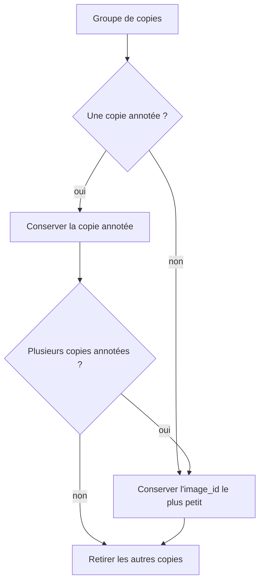

# Doublons

Notebook : `notebooks/02.0-kl-duplicates-analysis.ipynb`

Le notebook d'exploration a repéré des fichiers identiques. Cette page caractérise ces doublons et justifie la règle de déduplication implémentée dans `brain_mri.dataset`. Les données brutes ne sont jamais modifiées.

## Pourquoi c'est important

Dans une approche semi-supervisée, une image annotée dont une copie non annotée est pseudo-labellisée, ou placée dans un autre découpage, fait fuiter l'ensemble d'évaluation vers l'apprentissage. L'évaluation devient alors artificiellement optimiste.

## Doublons exacts

Un groupe rassemble les fichiers de même empreinte SHA-256.

- **90 groupes**, **186 fichiers** impliqués, soit **96 copies en trop**.
- **Aucun groupe n'a de labels contradictoires** : un même contenu ne porte jamais à la fois `cancer` et `normal`.

| Taille du groupe | `cancer` | `normal` | `sans_label` | Groupes |
|---:|---:|---:|---:|---:|
| 2 | 0 | 0 | 2 | 55 |
| 2 | 0 | 1 | 1 | 21 |
| 2 | 1 | 0 | 1 | 8 |
| 3 | 0 | 0 | 3 | 4 |
| 3 | 0 | 1 | 2 | 1 |
| 3 | 0 | 2 | 1 | 1 |

- **31 groupes contiennent une image annotée**, dont 29 avec une copie non annotée : c'est là que le risque de fuite est réel.
- Une image `normal` est annotée **deux fois** : le jeu annoté perd mécaniquement une image à la déduplication.

## Quasi-doublons

Le hash binaire ne détecte pas une image ré-encodée ou légèrement modifiée. Pour estimer ce risque :

1. chaque image dédupliquée est réduite à une miniature **32 × 32 en niveaux de gris** ;
2. on cherche son plus proche voisin (distance euclidienne, pixels dans [0, 1]) ;
3. les paires sous un seuil de **0,15** sont retenues.

Le seuil est choisi par inspection de l'histogramme des distances, qui montre une queue de valeurs très faibles nettement séparée du reste, puis par inspection visuelle des paires.

| Paires de quasi-doublons | Nombre |
|---|---:|
| `sans_label` + `sans_label` | 18 |
| `normal` + `sans_label` | 5 |
| `normal` + `normal` | 1 |
| **Total** | **24** |

Les paires inspectées sont visuellement identiques : la différence absolue entre les images en pleine résolution est quasi nulle. La figure montre en priorité les paires qui impliquent une image annotée.

## Règle de déduplication

Pour chaque groupe de doublons exacts, puis pour chaque paire de quasi-doublons, **une seule copie est conservée** :

1. une copie **annotée** est conservée en priorité, pour ne jamais perdre l'information du label ;
2. sinon, ou à égalité, on conserve l'`image_id` le plus petit, ce qui rend le choix reproductible.

## Effet de la déduplication

| Sous-ensemble | Brut | Sans doublons exacts | Sans quasi-doublons |
|---|---:|---:|---:|
| `cancer` | 50 | 50 | 50 |
| `normal` | 50 | 49 | 48 |
| `sans_label` | 1 406 | 1 311 | 1 289 |
| **Total** | **1 506** | **1 410** | **1 387** |

Le jeu annoté final compte **98 images** (50 `cancer`, 48 `normal`). Il reste équilibré à deux images près, ce qui est à garder en tête pour les métriques.

Ces chiffres sont ceux de la déduplication seule. Le manifeste final compte **1 386 images**, car une image inexploitable est ensuite exclue (voir [Qualité des images](qualite-images.md)).

## Limites

- Le seuil de 0,15 est choisi par inspection : il est documenté dans le code (`NEAR_DUPLICATE_THRESHOLD`) mais reste un choix.
- Chaque image n'est comparée qu'à son plus proche voisin, sur des miniatures. Une image retournée ou pivotée ne serait pas détectée.
- Les paires de quasi-doublons sont validées visuellement par l'auteur, pas par un radiologue.
