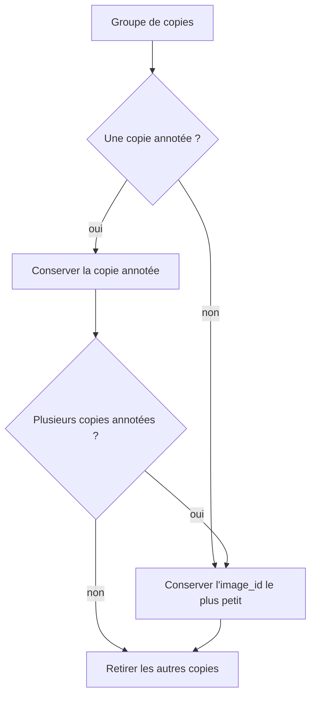

# Doublons

Notebook : `notebooks/02.01-kl-data-cleaning.ipynb`

Le notebook d'exploration a repéré des fichiers identiques. Cette page caractérise les doublons, exacts et quasi-doublons, et justifie la règle de déduplication implémentée dans `brain_mri.dataset`. Les données brutes ne sont jamais modifiées.

## Pourquoi c'est important

Dans une approche semi-supervisée, une image annotée dont une copie non annotée est pseudo-labellisée, ou placée dans un autre découpage, fait fuiter l'ensemble d'évaluation vers l'apprentissage. L'évaluation devient alors artificiellement optimiste.

Une copie **retournée** ou **pivotée** du même examen est aussi dangereuse qu'une copie identique : si l'une est en entraînement et l'autre en test, le test n'est plus « jamais vu ».

## Images illisibles et image exclue

Les 1 506 fichiers se décodent : aucune image illisible. Une image est exclue à la main avant la déduplication (voir [Qualité des images](qualite-images.md)) : il reste 1 505 images.

## Doublons exacts

Un groupe rassemble les fichiers de même empreinte SHA-256.

- **90 groupes**, **186 fichiers** impliqués, soit **96 copies en trop**.
- **Aucun groupe n'a de labels contradictoires** : un même contenu ne porte jamais à la fois `cancer` et `normal`.

| Taille du groupe | `cancer` | `normal` | `sans_label` | Groupes |
|---:|---:|---:|---:|---:|
| 2 | 0 | 0 | 2 | 55 |
| 2 | 0 | 1 | 1 | 21 |
| 2 | 1 | 0 | 1 | 8 |
| 3 | 0 | 0 | 3 | 4 |
| 3 | 0 | 1 | 2 | 1 |
| 3 | 0 | 2 | 1 | 1 |

- **31 groupes contiennent une image annotée**, dont 29 avec une copie non annotée : c'est là que le risque de fuite est réel.
- Une image `normal` est annotée **deux fois** : le jeu annoté perd mécaniquement une image à la déduplication.

## Quasi-doublons

Le hash binaire ne détecte pas une image ré-encodée, légèrement modifiée, retournée ou pivotée. On compare donc des miniatures.

### Première approche : l'orientation d'origine seule

Chaque image est réduite à une miniature **32 × 32** en niveaux de gris, comparée à ses voisines dans son orientation d'origine (distance euclidienne, seuil de 0,15). Elle trouve **24 paires**. Elle laisse passer toute copie retournée ou pivotée : l'image ne ressemble plus pixel à pixel à son original.

### Approche retenue : les 8 orientations

Chaque image est comparée aux **8 orientations** des autres, c'est-à-dire les symétries du carré (4 rotations, avec ou sans miroir). Deux changements rendent la comparaison robuste :

- les miniatures passent à **64 × 64**, pour garder plus de détail ;
- la distance est l'**écart quadratique moyen** (RMS) entre pixels dans [0, 1], c'est-à-dire la distance euclidienne divisée par le côté de la miniature, pour que le seuil ne dépende pas de sa taille.

| RMS maximal | Orientation d'origine seule | 8 orientations | dont retournées ou pivotées |
|---:|---:|---:|---:|
| 0,005 | 18 | 94 | 78 |
| 0,010 | 29 | 110 | 86 |
| **0,020** | **36** | **125** | **94** |
| 0,030 | 43 | 137 | 100 |
| 0,040 | 64 | 166 | 109 |

Les paires retournées ou pivotées sont plus nombreuses que celles de l'orientation d'origine : la première approche en manquait la majorité.

### Où placer le seuil : revue visuelle

Les paires sont regroupées par bandes de distance. Pour chaque bande, six paires tirées au hasard montrent l'image A remise dans l'orientation de l'image B, l'image B et leur différence absolue : une copie donne une différence quasi noire.

- **Sous 0,02**, les paires sont des **copies** : la différence ne montre que du bruit de compression, même lorsque l'image est retournée ou pivotée. Dans une partie des paires, une copie est moins nette que l'autre.
- **De 0,02 à 0,03**, on trouve encore des copies légèrement décalées ou à une autre échelle, mêlées à des coupes voisines.
- **Au-delà de 0,03**, ce sont surtout des **coupes voisines d'un même examen** : elles se ressemblent, mais ce ne sont pas des copies.

On retient un seuil de **0,02** : on retire les copies sans retirer des images distinctes. Il est conservateur pour les images annotées, dont chacune compte. La **zone grise** entre 0,02 et 0,04 compte 41 paires, dont 5 impliquent une image annotée.

### Résultat sous le seuil de 0,02

**125 paires**, dont 94 retournées ou pivotées : 63 miroirs gauche-droite, 19 rotations de 180°, 12 miroirs haut-bas, et 31 copies dans l'orientation d'origine.

| Paires de quasi-doublons | Nombre |
|---|---:|
| `sans_label` + `sans_label` | 91 |
| `normal` + `sans_label` | 25 |
| `cancer` + `sans_label` | 6 |
| `normal` + `normal` | 3 |
| **Total** | **125** |

**Aucune paire n'a de labels contradictoires.**

## Règle de déduplication

Pour chaque groupe de doublons exacts, puis pour chaque paire de quasi-doublons, **une seule copie est conservée** :

1. une copie **annotée** est conservée en priorité, pour ne jamais perdre l'information du label ;
2. sinon, ou à égalité, on conserve l'`image_id` le plus petit, ce qui rend le choix reproductible.

Le rapport des suppressions (`reports/removed_duplicates.csv`) indique, pour chaque quasi-doublon retiré, l'orientation qui le rattache à l'image conservée (colonne `transform`).

## Effet de la déduplication

| Sous-ensemble | Brut | Sans l'image exclue | Sans doublons exacts | Sans quasi-doublons |
|---|---:|---:|---:|---:|
| `cancer` | 50 | 50 | 50 | 50 |
| `normal` | 50 | 50 | 49 | 47 |
| `sans_label` | 1 406 | 1 405 | 1 310 | 1 194 |
| **Total** | **1 506** | **1 505** | **1 409** | **1 291** |

- **118 quasi-doublons sont retirés** : 91 copies retournées ou pivotées (61 miroirs gauche-droite, 18 rotations de 180°, 12 miroirs haut-bas) et 27 copies dans l'orientation d'origine.
- Le jeu annoté final compte **97 images** (50 `cancer`, 47 `normal`). Il reste équilibré à trois images près, ce qui est à garder en tête pour les métriques.

## Limites

- Les **coupes voisines d'un même examen** ne sont pas des copies et ne sont pas retirées : sans métadonnées de patient, un risque de fuite subsiste entre apprentissage et évaluation.
- Le seuil de 0,02 est choisi par inspection visuelle des paires, pas par un radiologue. La zone grise de 0,02 à 0,04 reste ouverte.
- Chaque image n'est comparée qu'à sa plus proche voisine : une image qui aurait plusieurs copies est repérée par sa plus proche seulement.
