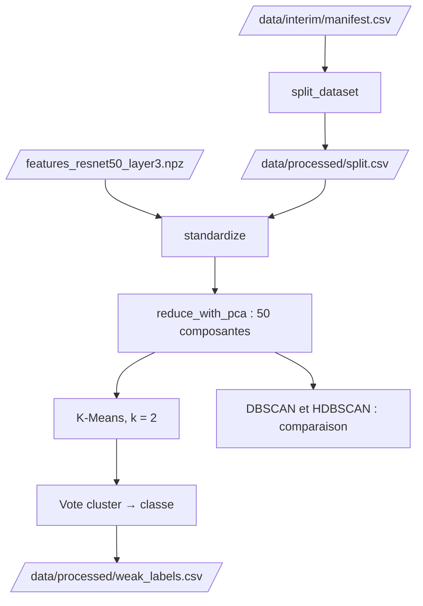

# Analyse non supervisée

Notebook : `notebooks/03.01-kl-unsupervised-analysis.ipynb`

Les features de l'étape précédente servent à **regrouper les images**, puis à attribuer un **label faible** aux images non annotées. Le découpage est implémenté dans `brain_mri.dataset`, la standardisation et la PCA dans `brain_mri.modeling.preprocessing`, le clustering et les labels faibles dans `brain_mri.modeling.unsupervised`. Les labels faibles se produisent avec `make unsupervised`.

## Flux



## Trois jeux, définis avant toute transformation

La standardisation, la PCA et le clustering **s'ajustent sur des données**. Si le jeu de test participait à cet ajustement, il ne serait plus « jamais vu ». Le [découpage](preparation.md) est donc fait en premier :

| Jeu | Rôle |
|---|---|
| **Entraînement** (1 340 images : 52 annotées et 1 288 non annotées) | Ajuste la standardisation, la PCA et les clusterings, et sert au vote cluster → classe |
| **Validation** (16 images annotées) | Vérifications en cours de route ; à l'étape suivante, arrêt anticipé de l'entraînement |
| **Test** (30 images annotées) | Évaluation finale |

## Standardisation et PCA

Chaque dimension est centrée et réduite avec le `StandardScaler` ajusté sur l'**entraînement uniquement**, puis la PCA, ajustée sur le même jeu, garde **50 composantes**. Elles portent **74 %** de la variance pour `layer3` et **47,5 %** pour `layer4`. Le t-SNE ne sert qu'à la visualisation.

Hors entraînement (images annotées uniquement), la moyenne des features standardisées s'écarte de 0 (0,268 pour `layer3`, 0,161 pour `layer4`) : les images annotées ne suivent pas exactement la distribution des non annotées.


Sur `layer3`, les `cancer` annotées se trouvent surtout dans des **îlots compacts** et les `normal` dans une zone plus diffuse. Sur `layer4`, les classes se mélangent davantage. Ces îlots regroupent des images très proches (même coupe ou même série ?) : faute de métadonnées, on ne peut pas le vérifier.

## Clustering

On cherche **deux groupes**, comme dans le jeu annoté. La qualité se mesure par l'**ARI** (*Adjusted Rand Index*) entre les clusters et les labels forts : 1 pour un accord parfait, 0 pour un accord équivalent au hasard. Il est calculé sur les images annotées, avec très peu d'images : les valeurs sont **indicatives**.

| Méthode | Principe | Paramètres |
|---|---|---|
| **K-Means** | Deux groupes compacts autour de deux centres | `k = 2`, 10 initialisations, seed fixe |
| **DBSCAN** | Zones denses, le reste est du bruit | `min_samples`, `eps` (quantiles de la courbe des k plus proches voisins) |
| **HDBSCAN** | DBSCAN pour tous les rayons, garde les groupes persistants | `min_cluster_size`, `min_samples` |

Le **bruit** (cluster `-1`) est un résultat attendu de DBSCAN et HDBSCAN. Il est rapporté, mais il n'est **ni un cluster, ni une classe** : l'ARI est calculé sur les images annotées qui appartiennent à un cluster.

### Résultats sur `layer3`

Pour DBSCAN et HDBSCAN, la configuration retenue est celle de la grille (24 configurations chacun) qui a au moins deux clusters, au plus 30 % de bruit et le meilleur ARI hors bruit. Elle sert à illustrer ces méthodes.

| Méthode | Clusters | Bruit à l'entraînement | ARI entraînement | ARI validation | ARI test |
|---|---:|---:|---:|---:|---:|
| K-Means | 2 | 0 % | 0,199 | 0,354 | 0,341 |
| DBSCAN | 13 | 22 % | 0,180 | 0,253 | 0,023 |
| HDBSCAN | 5 | 28 % | 0,164 | 0,182 | -0,013 |

- **`layer3` est meilleure que `layer4`** : l'ARI de K-Means y est de 0,199 contre 0,106. Sur `layer4`, DBSCAN ne forme qu'un seul cluster et HDBSCAN laisse au moins 44 % des images en bruit.
- **K-Means est stable** : même résultat pour 10, 20 et 50 composantes comme pour les features complètes, et pour 10 seeds (ARI minimal de 1,000 sur `layer3`, 0,964 sur `layer4`).
- **DBSCAN et HDBSCAN** laissent 25 à 43 % d'images en bruit sur la validation et le test. Leur ARI hors bruit tombe à environ 0 sur le test, alors que celui de K-Means se maintient. L'écart est à relativiser : leur configuration est choisie parmi 24 sur l'entraînement, et l'ARI repose sur très peu d'images (12 et 11 sur la validation, 19 et 17 sur le test). Les images de validation et de test sont rattachées au groupe de leur plus proche voisin de l'entraînement : c'est une approximation, ces méthodes n'ayant pas de `predict`.
- **Cohérence entre méthodes** : DBSCAN et HDBSCAN retrouvent presque la même structure (ARI de 0,954), alors que K-Means n'en retrouve qu'une partie (0,327 et 0,344).


## Labels faibles

Un cluster n'a pas de sens médical : on attribue à chaque cluster de K-Means la classe **majoritaire** parmi ses images annotées de l'entraînement (égalité : `normal`), puis ce label faible à toutes les images du cluster. Seul K-Means fournit des labels faibles : les images laissées en bruit par DBSCAN et HDBSCAN n'auraient pas de classe.


### Confiance

Chaque label faible porte une **confiance** `(d2 - d1) / (d2 + d1)`, où `d1` est la distance au centre le plus proche et `d2` la distance à l'autre centre. Elle vaut 0 à égale distance des deux centres et 1 sur le centre. C'est une **marge géométrique, pas une probabilité** d'avoir le bon label, et elle n'est pas validée.

### Fichier produit : `data/processed/weak_labels.csv`

Une ligne par image **non annotée**.

| Colonne | Contenu |
|---|---|
| `image_id` | L'image |
| `cluster` | Cluster de K-Means |
| `weak_label` | `cancer` ou `normal` |
| `confidence` | Marge entre les deux centres, entre 0 et 1 |
| `method` | `K-Means` |

Les 1 288 images reçoivent **841 `normal` et 447 `cancer`** (35 % de `cancer`, contre 52 % parmi les annotées de l'entraînement). La répartition réelle des non annotées est inconnue : cet écart est un signal, pas une preuve. La confiance est faible : médiane de 0,20 pour `cancer` et 0,14 pour `normal`, maximum de 0,37.

### Qualité sur des images jamais vues

| Jeu | Images | Exactitude | Intervalle de confiance à 95 % | Exactitude équilibrée |
|---|---:|---:|---|---:|
| Entraînement (optimiste : le vote utilise ces images) | 52 | 0,731 | | |
| Validation | 16 | 0,812 | [0,570 ; 0,934] | 0,812 |
| Test | 30 | 0,800 | [0,627 ; 0,905] | 0,800 |

| Jeu | Classe | Précision | Rappel | F1 | Images |
|---|---|---:|---:|---:|---:|
| Validation | `cancer` | 1,000 | 0,625 | 0,769 | 8 |
| Validation | `normal` | 0,727 | 1,000 | 0,842 | 8 |
| Test | `cancer` | 1,000 | 0,600 | 0,750 | 15 |
| Test | `normal` | 0,714 | 1,000 | 0,833 | 15 |

Sur les 23 `cancer` annotées de la validation et du test, K-Means en étiquette 9 `normal` ; il n'étiquette jamais `cancer` une image `normal`. Ces chiffres ne valent que pour les images annotées : on ne sait pas comment K-Means se comporte sur les 1 288 autres.

### Que capturent les clusters ?

AUC de chaque descripteur des **images d'origine** pour prédire le label (0,5 : aucune séparation).

| Descripteur | Label fort | Label faible K-Means |
|---|---:|---:|
| Luminosité | 0,347 | 0,448 |
| Contraste | 0,236 | 0,272 |
| Part de fond | 0,578 | 0,328 |

Les labels faibles suivent le contraste à peu près comme les labels forts : on ne peut pas démontrer que les clusters capturent la pathologie plutôt que le contraste, les deux étant liés dans ce jeu de données. Pour la part de fond, ils s'écartent de 0,5 en sens opposé aux labels forts : K-Means s'appuie en partie sur un indice d'acquisition que les labels forts utilisent peu.

!!! warning "Limites"
    - Le choix des méthodes repose sur 52 images annotées et leur évaluation sur 16 et 30 : les écarts de quelques points ne sont pas significatifs.
    - Les images annotées ne suivent pas exactement la distribution des non annotées : ce que les 52 annotées disent des 1 288 autres est limité.
    - Les labels faibles ont une confiance faible, une proportion de `cancer` non vérifiable et une dépendance partielle à la part de fond.

## Lancer le calcul

```bash
make unsupervised
```

La commande lit le manifeste, le découpage et les features de `layer3`, ajuste la standardisation, la PCA et K-Means sur l'entraînement, puis écrit `data/processed/weak_labels.csv`. Les valeurs de `confidence` peuvent différer d'environ 10⁻⁷ d'une exécution à l'autre (calcul en `float32`) ; les clusters et les labels faibles sont identiques.

```bash
uv run python -m brain_mri.modeling.unsupervised \
    --manifest-path data/interim/manifest.csv \
    --split-path data/processed/split.csv \
    --features-dir data/processed \
    --output-path data/processed/weak_labels.csv \
    --layer layer3
```

Les grilles DBSCAN et HDBSCAN, l'attribution par plus proche voisin et les graphiques sont dans le notebook.
