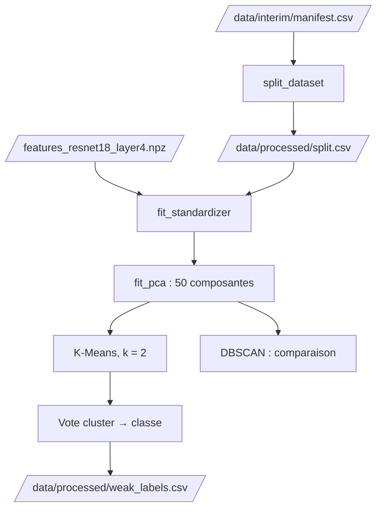

# Analyse non supervisée

Notebook : `notebooks/03.01-kl-unsupervised-analysis.ipynb`

Les features de l'étape précédente servent à **regrouper les images**, puis à attribuer un **label faible** aux images non annotées. Le découpage est implémenté dans `brain_mri.dataset`, la standardisation et la PCA dans `brain_mri.modeling.preprocessing`, le clustering et les labels faibles dans `brain_mri.modeling.unsupervised`. Les labels faibles se produisent avec `make unsupervised`.

Chaque clustering testé est suivi dans MLflow (un run par configuration, voir [Conventions](../conventions.md#suivi-des-experiences)) : `make mlflow-ui`.

## Flux



## Trois jeux, définis avant toute transformation

La standardisation, la PCA et le clustering **s'ajustent sur des données**. Si le jeu de test participait à cet ajustement, il ne serait plus « jamais vu ». Le [découpage](preparation.md) est donc fait en premier :

| Jeu | Rôle |
|---|---|
| **Entraînement** (1 262 images : 68 annotées et 1 194 non annotées) | Ajuste la standardisation, la PCA et les clusterings, et sert au vote cluster → classe |
| **Validation** (14 images annotées) | Vérifications en cours de route ; à l'étape suivante, arrêt anticipé de l'entraînement |
| **Test** (15 images annotées) | Évaluation finale |

## Standardisation et PCA

Chaque dimension est centrée et réduite avec le `StandardScaler` ajusté sur l'**entraînement uniquement**, puis la PCA, ajustée sur le même jeu, garde **50 composantes**. Elles portent **84,4 %** de la variance pour `layer3` et **73,0 %** pour `layer4`. Le t-SNE ne sert qu'à la visualisation, sur l'entraînement.

Hors entraînement (images annotées uniquement), la moyenne des features standardisées s'écarte de 0 (0,249 pour `layer3`, 0,212 pour `layer4`, en valeur absolue moyenne par dimension) : les images annotées ne suivent pas exactement la distribution des non annotées.


Sur `layer4`, les `normal` annotées se regroupent surtout à droite de la PCA et dans une même zone du t-SNE, alors que les `cancer` sont plus dispersées, avec un recouvrement. Sur `layer3`, les `cancer` forment surtout des îlots à gauche et en bas, et les `normal` sont dispersées au centre.

## Clustering

On cherche **deux groupes**, comme dans le jeu annoté. La qualité se mesure par l'**ARI** (*Adjusted Rand Index*) entre les clusters et les labels forts : 1 pour un accord parfait, 0 pour un accord équivalent au hasard. Il est calculé sur les 68 images annotées de l'entraînement, avec très peu d'images : les valeurs sont **indicatives**.

| Méthode | Principe | Paramètres |
|---|---|---|
| **K-Means** | Deux groupes compacts autour de deux centres | `k = 2`, 10 initialisations, seed fixe |
| **DBSCAN** | Zones denses, le reste est du bruit | `min_samples`, `eps` (quantiles de la courbe des k plus proches voisins) |

Le **bruit** (cluster `-1`) est un résultat attendu de DBSCAN. Il est rapporté, mais il n'est **ni un cluster, ni une classe** : l'ARI est calculé sur les images annotées qui appartiennent à un cluster.

### Résultats sur `layer4`

Pour DBSCAN, la configuration retenue est celle de la grille (12 configurations sur `layer4`) qui a au moins deux clusters, au plus 30 % de bruit et le meilleur ARI hors bruit. Elle sert à illustrer la méthode.

| Méthode | Clusters | Couverture à l'entraînement | ARI entraînement | ARI validation | ARI test |
|---|---:|---:|---:|---:|---:|
| K-Means | 2 | 100 % | 0,337 | 0,122 | 0,504 |
| DBSCAN | 3 | 84 % | 0,266 | non évalué | non évalué |

- **`layer4` est meilleure que `layer3`** : l'ARI de K-Means y est de 0,337 contre 0,092.
- **K-Means est stable** : même ARI pour 10, 20 et 50 composantes comme pour les features complètes (0,337 sur `layer4`) et même résultat pour 10 seeds (ARI minimal de 1,000 sur `layer3`, 0,994 sur `layer4`).
- **DBSCAN** suppose des zones denses, ce que le nuage de points n'offre pas : sur `layer4`, une seule des 12 configurations forme plusieurs clusters (trois), les 11 autres n'en forment qu'un. La configuration retenue laisse 16 % des images en bruit, donc sans classe, et son ARI (0,266) porte sur 47 images annotées sur 68 : il reste inférieur à celui de K-Means (0,337).


Sur les annotées de l'entraînement, K-Means rate **13 `cancer` sur 35** et prend **1 `normal` sur 33** pour un `cancer`. DBSCAN rate 11 `cancer` sur 35 et laisse 21 images sans classe (6 `cancer`, 15 `normal`) ; son ARI reste inférieur à celui de K-Means.


### Nombre de clusters

Le jeu annoté compte deux classes, mais rien n'oblige les images à former deux groupes. On fait varier `k` de 2 à 6 sur `layer4` :

| `k` | Inertie | Silhouette | ARI | Pureté |
|---:|---:|---:|---:|---:|
| **2** | 414 241 | 0,122 | 0,337 | 0,794 |
| 3 | 387 224 | 0,120 | 0,357 | 0,824 |
| 4 | 363 113 | 0,118 | 0,250 | 0,809 |
| 5 | 345 865 | 0,121 | 0,213 | 0,794 |
| 6 | 333 445 | 0,118 | 0,253 | 0,838 |

Aucun nombre de clusters ne se détache : l'inertie baisse régulièrement sans coude net, la silhouette reste voisine de 0,12 et l'ARI fluctue. La pureté monte avec `k` par construction, car des clusters plus petits sont plus faciles à rendre homogènes. Avec `k = 3`, le groupe de gauche de la PCA se sépare en deux (haut et bas) et celui de droite reste à peu près entier ; l'écart d'ARI (0,36 contre 0,34) est faible. **On garde `k = 2`**, qui correspond aux deux classes du jeu annoté.


### Seuil de décision

En contexte médical, rater un cancer est plus grave qu'une fausse alerte. On teste une règle plus prudente que « centre le plus proche » : étiqueter `cancer` quand le rapport `d_cancer / (d_cancer + d_normal)` est inférieur à un seuil supérieur à 0,5. Le seuil est choisi sur les images annotées de l'**entraînement** (rappel de `cancer` maximal avec au plus 20 % de fausses alertes), la validation le vérifie et le test n'est pas utilisé.

| Jeu | Seuil | Rappel `cancer` | Fausses alertes | ARI |
|---|---:|---:|---:|---:|
| Entraînement | 0,50 | 0,629 | 3,0 % | 0,337 |
| Entraînement | 0,53 | 0,714 | 12,1 % | 0,336 |
| Validation | 0,50 | 0,571 | 14,3 % | 0,122 |
| Validation | 0,53 | 0,571 | 14,3 % | 0,122 |

Le gain sur l'entraînement **ne se confirme pas sur des images jamais vues** : sur la validation, rien ne change (rappel de 0,57, fausses alertes de 14 %). Un seuil choisi sur 68 images s'ajuste à elles : on garde la règle de K-Means, au seuil de 0,50.


## Labels faibles

Un cluster n'a pas de sens médical : on attribue à chaque cluster de K-Means la classe **majoritaire** parmi ses images annotées de l'entraînement (égalité : `normal`), puis ce label faible à toutes les images du cluster. Seul K-Means fournit des labels faibles : les images laissées en bruit par DBSCAN n'auraient pas de classe.


### Confiance

Chaque label faible porte une **confiance** `(d2 - d1) / (d2 + d1)`, où `d1` est la distance au centre le plus proche et `d2` la distance à l'autre centre. Elle vaut 0 à égale distance des deux centres et 1 sur le centre. C'est une **marge géométrique, pas une probabilité** d'avoir le bon label, et elle n'est pas validée.

### Fichier produit : `data/processed/weak_labels.csv`

Une ligne par image **non annotée**.

| Colonne | Contenu |
|---|---|
| `image_id` | L'image |
| `cluster` | Cluster de K-Means |
| `weak_label` | `cancer` ou `normal` |
| `confidence` | Marge entre les deux centres, entre 0 et 1 |
| `method` | `K-Means` |

Les 1 194 images reçoivent **643 `cancer` et 551 `normal`** (54 % de `cancer`, contre 51 % parmi les annotées de l'entraînement). La répartition réelle des non annotées est inconnue : ce rapprochement ne prouve rien, il signale seulement l'absence d'écart.

La confiance est faible : médiane de 0,12 pour `cancer` et de 0,13 pour `normal`, maximum de 0,27. Sur les 1 194 labels faibles, 428 sont indécis (confiance sous 0,10), 688 hésitants et **78 seulement confiants** (0,20 et plus). Les `normal` sont plus de dix fois plus souvent confiants que les `cancer`.


Les images les plus confiantes du label `cancer` sont des coupes coronales ou sagittales, celles du label `normal` des coupes axiales. Plusieurs images du label `normal` montrent pourtant une masse visible : la confiance mesure la **proximité du centre**, pas l'absence de tumeur. Le regroupement semble suivre le plan de coupe autant que la pathologie.


### Qualité sur des images jamais vues

| Jeu | Images | Exactitude | Intervalle de confiance à 95 % | Exactitude équilibrée |
|---|---:|---:|---|---:|
| Entraînement (optimiste : le vote utilise ces images) | 68 | 0,794 | | |
| Validation | 14 | 0,714 | [0,454 ; 0,883] | 0,714 |
| Test | 15 | 0,867 | [0,621 ; 0,963] | 0,875 |

| Jeu | Classe | Précision | Rappel | F1 | Images |
|---|---|---:|---:|---:|---:|
| Validation | `cancer` | 0,800 | 0,571 | 0,667 | 7 |
| Validation | `normal` | 0,667 | 0,857 | 0,750 | 7 |
| Test | `cancer` | 1,000 | 0,750 | 0,857 | 8 |
| Test | `normal` | 0,778 | 1,000 | 0,875 | 7 |

Sur les 29 images jamais vues, le label faible se trompe **6 fois** : 5 `cancer` étiquetées `normal` (3 sur 7 à la validation, 2 sur 8 au test) et une `normal` étiquetée `cancer` (à la validation). Sur les 68 annotées de l'entraînement, il se trompe 14 fois (13 `cancer` étiquetées `normal` et une `normal` étiquetée `cancer`), une mesure optimiste. Ces chiffres ne valent que pour les images annotées : on ne sait pas comment K-Means se comporte sur les 1 194 autres.


Sur la PCA et le t-SNE, les erreurs se trouvent surtout dans la partie droite, du côté où les `normal` annotées sont nombreuses : ce sont des `cancer` dont l'image ressemble à celles des `normal`. Plusieurs d'entre elles montrent pourtant une masse claire visible.


### Que capturent les clusters ?

Des indices d'acquisition (luminosité, contraste, part de fond noir) séparent en partie `cancer` et `normal` malgré l'égalisation (voir [Qualité des images](../donnees/qualite-images.md)). Les clusters pourraient suivre ces indices plutôt que la pathologie. On mesure l'AUC de chaque descripteur des **images d'origine** pour prédire le label (0,5 : aucune séparation), sur les **mêmes 68 images annotées** pour les labels forts et les labels faibles : la comparaison n'a de sens que sur les mêmes images. Les intervalles à 95 % viennent d'un rééchantillonnage.

| Descripteur | Label fort | Label faible K-Means (mêmes 68) | Label faible K-Means (1 262 images) |
|---|---|---|---:|
| Luminosité | 0,334 [0,20 ; 0,46] | 0,435 [0,31 ; 0,57] | 0,500 |
| Contraste | 0,201 [0,09 ; 0,31] | 0,271 [0,16 ; 0,39] | 0,412 |
| Part de fond | 0,552 [0,41 ; 0,68] | 0,396 [0,26 ; 0,53] | 0,408 |

Les labels faibles suivent la luminosité et le contraste un peu moins que les labels forts, avec des intervalles qui se recouvrent largement : **on ne peut pas montrer que le clustering exploite moins ces indices d'acquisition que la pathologie**. Pour la part de fond, les AUC diffèrent mais les intervalles se recouvrent aussi. L'AUC sur 1 262 images, plus proche de 0,5, ne se compare pas aux labels forts, mesurés sur 68 images.

### Que regardent les deux groupes ?

Les deux clusters ont chacun un centre dans l'espace de la PCA. La **direction** qui va du centre `normal` au centre `cancer` indique ce qui distingue les deux groupes. On la ramène dans l'espace des caractéristiques (PCA inverse, puis division par l'écart-type de la standardisation). Le pooling global étant une moyenne des cartes spatiales de `layer4` (7 × 7), le score d'une image sur cette direction est la **moyenne** d'une carte obtenue en sommant les 512 cartes pondérées par la direction : le calcul est vérifié sur une image (score direct et moyenne de la carte identiques).

La carte est **centrée sur le milieu des deux centres**, c'est-à-dire sur la frontière entre les clusters : un score positif est du côté `cancer` (rouge), un score négatif du côté `normal` (bleu). Sans ce centrage, le rouge et le bleu seraient arbitraires. La limite de couleur est commune à toutes les images pour une direction donnée. On compare avec la direction des **labels forts** de l'entraînement (similarité cosinus de 0,71).


- **Zones.** Les zones rouges se trouvent surtout au centre et en bas de la tête (base du crâne, région du visage), les zones bleues sur l'ensemble du cerveau. Sur les deux coupes coronales très confiantes, la zone rouge recouvre la région de la tumeur sans s'y limiter et s'étend jusqu'aux bords de l'image : **les cartes ne localisent pas la lésion**, et semblent suivre la position dans l'image plus que la structure visible. La résolution de `layer4` (7 × 7) est une explication possible, que le notebook ne démontre pas.
- **Plan de coupe.** Les scores les plus élevés côté `cancer` sont des coupes sagittales ou coronales, les plus bas côté `normal` des coupes axiales. Les deux images mal étiquetées vont dans ce sens : la `cancer` classée `normal` est une coupe axiale, la `normal` classée `cancer` une coupe coronale. Sans métadonnées, on ne peut pas le vérifier.
- **Deux directions.** Elles donnent des cartes proches pour les images bien étiquetées et divergent pour la `cancer` mal étiquetée (score de K-Means de −122, score des labels forts de +7) et pour les images au label faible incertain, dont le score de K-Means est proche de 0 : leur carte est alors pâle.

!!! warning "Limites"
    - Le choix des méthodes repose sur 68 images annotées et leur évaluation sur 14 et 15 : les écarts de quelques points ne sont pas significatifs.
    - Les images annotées ne suivent pas exactement la distribution des non annotées : ce que les 68 annotées disent des 1 194 autres est limité.
    - Les labels faibles ont une confiance faible, une proportion de `cancer` non vérifiable, et les clusters suivent en partie la luminosité et le contraste.
    - Les cartes directionnelles sont grossières (7 × 7) et ne localisent pas la lésion.

## Lancer le calcul

```bash
make unsupervised
```

La commande lit le manifeste, le découpage et les features de `layer4`, ajuste la standardisation, la PCA et K-Means sur l'entraînement, puis écrit `data/processed/weak_labels.csv`. Les valeurs de `confidence` peuvent différer d'environ 10⁻⁷ d'une exécution à l'autre (calcul en `float32`) ; les clusters et les labels faibles sont identiques.

```bash
uv run python -m brain_mri.modeling.unsupervised \
    --manifest-path data/interim/manifest.csv \
    --split-path data/processed/split.csv \
    --features-dir data/processed \
    --output-path data/processed/weak_labels.csv \
    --layer layer4
```

La grille DBSCAN, le balayage de `k`, le seuil de décision, les erreurs et les cartes directionnelles sont dans le notebook.
