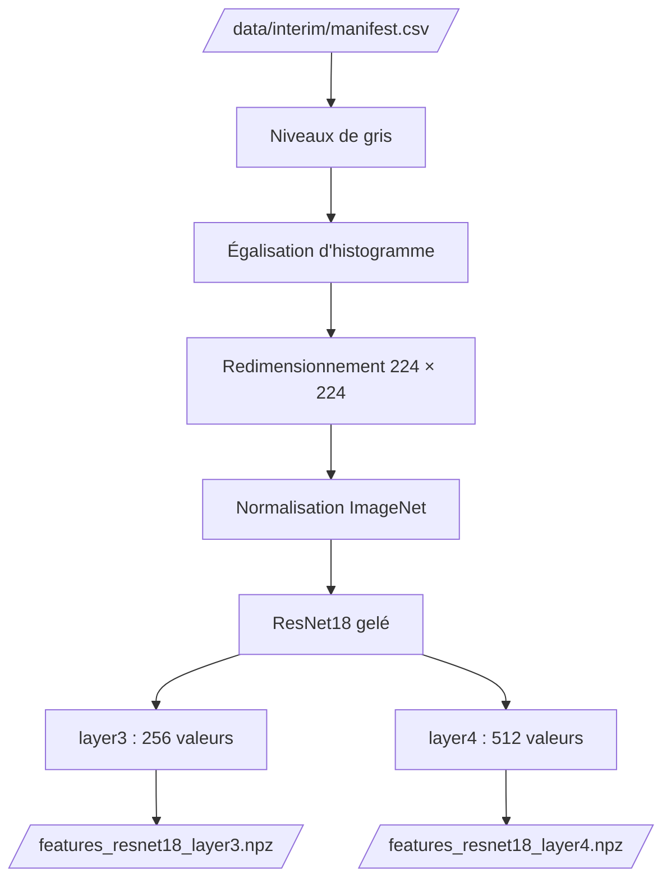

# Extraction des features

Notebook : `notebooks/02.02-kl-feature-extraction.ipynb`

L'extraction transforme chaque image du manifeste en **vecteurs de caractéristiques**, grâce à un modèle pré-entraîné, pour l'analyse non supervisée de l'étape suivante. Elle est implémentée dans `brain_mri.features`, et les cartes d'attention dans `brain_mri.attention`.

## Flux



## Prétraitement

| Étape | Rôle |
|---|---|
| 1. Niveaux de gris, recopiés sur 3 canaux | **Réduire les biais liés à l'image** : supprime les artefacts de couleur (7 images du manifeste). Le ResNet attend 3 canaux |
| 2. Égalisation d'histogramme, en pleine résolution | **Réduire les biais liés à l'image** : gomme les différences globales de luminosité et de contraste |
| 3. Redimensionnement à 224 × 224, sans rognage | Adapter l'image au modèle, sans couper d'anatomie en bordure |
| 4. Normalisation avec les statistiques d'ImageNet | Adapter l'image à la distribution d'entraînement du modèle |


### Pourquoi les étapes 1 et 2

Trois prétraitements sont comparés sur les 97 images annotées, avec un modèle de référence (régression logistique, validation croisée stratifiée répétée, AUC moyenne ± écart-type). La colonne « descripteurs seuls » donne l'AUC d'un modèle qui ne voit que la luminosité, le contraste et la part de fond, **calculés après prétraitement** : elle mesure l'indice parasite qui reste.

| Prétraitement | `layer3` | `layer4` | Descripteurs seuls |
|---|---|---|---|
| RGB d'origine | 0,974 ± 0,040 | 0,949 ± 0,055 | 0,819 ± 0,095 |
| Niveaux de gris | 0,974 ± 0,040 | 0,949 ± 0,055 | 0,819 ± 0,095 |
| **Niveaux de gris + égalisation (retenu)** | **0,983 ± 0,031** | **0,977 ± 0,034** | **0,648 ± 0,136** |

- Sur les images d'origine, ces trois descripteurs suffisent à séparer en grande partie les classes annotées (AUC 0,82).
- Après égalisation, cet indice tombe à 0,65, alors que l'AUC des features ne baisse pas. Leur signal ne vient donc pas surtout de la luminosité ni du contraste globaux.

!!! warning "Limites"
    L'égalisation ne supprime pas tout le biais : il reste la part de fond. Elle ne corrige pas non plus les différences de séquence ou de source d'acquisition, faute de métadonnées. Avec 97 images annotées, ces mesures sont indicatives : les écarts entre prétraitements restent dans l'écart-type.

## Extraction

- **Modèle :** ResNet18 pré-entraîné sur ImageNet, dont les couches convolutives sont **gelées** : il ne sert qu'à produire des caractéristiques.
- **Couches :** `layer3` (caractéristiques de niveau intermédiaire, 256 valeurs) et `layer4` (haut niveau, dernière couche convolutive, 512 valeurs), chacune résumée par un **average pooling global**.
- **Calcul :** GPU si disponible (CUDA ou Apple MPS), sinon CPU.

| Fonction | Rôle |
|---|---|
| `preprocess_equalized` | Prétraitement retenu (les variantes `preprocess_rgb` et `preprocess_gray` servent à la comparaison) |
| `select_device` | Choisit CUDA, MPS ou CPU |
| `load_extractor` | Charge le ResNet18 gelé qui renvoie les couches voulues |
| `extract_features` | Un vecteur par image et par couche, dans l'ordre des images |
| `save_features`, `load_features` | Écrivent et relisent les fichiers `.npz` |

La signature complète figure dans la [référence](../reference/features.md).

## Fichiers produits

Un fichier `.npz` par couche dans `data/processed/` : `features_resnet18_layer3.npz` (1 291 × 256) et `features_resnet18_layer4.npz` (1 291 × 512).

Chaque fichier contient les `image_id` **et** la matrice, dans le même ordre : l'alignement avec le manifeste ne peut pas se perdre.

```python
from brain_mri.config import PROCESSED_DATA_DIR
from brain_mri.features import load_features

image_ids, features = load_features(
    PROCESSED_DATA_DIR / "features_resnet18_layer4.npz"
)
```

## Les features portent-elles un signal ?

| Couche | Silhouette des labels (cosinus) | Écart de similarité cosinus | AUC du modèle de référence |
|---|---:|---:|---|
| `layer3` | 0,160 | 0,011 | 0,983 ± 0,031 |
| `layer4` | 0,146 | 0,039 | 0,977 ± 0,034 |

- Les vecteurs sont valides : aucune valeur non finie, aucune dimension constante.
- La projection PCA montre une structure, avec un recouvrement. Sur `layer4`, les `normal` annotées se regroupent plutôt à droite et les `cancer` sont plus dispersées ; sur `layer3`, les `cancer` forment des îlots à gauche et en bas, et les `normal` sont plus diffuses.
- Les deux couches ne se départagent pas : `layer3` est devant sur la silhouette et l'AUC, `layer4` sur l'écart cosinus. L'écart d'AUC est inférieur à l'écart-type. **`layer4` est retenue** pour l'étape suivante.


## Cartes d'activation et d'attention

Deux regards sur ce que voit le ResNet18, **sans utiliser les labels ni le clustering**. Le but n'est pas d'interpréter les images médicalement, mais de vérifier que le réseau réagit à des structures visibles. Elles se calculent avec le ResNet18 **complet**, tête de classification comprise ; l'extraction des features n'est pas modifiée.

**Canaux les plus actifs de `layer4`.** Pour chaque image, on affiche les 16 canaux dont la carte moyenne est la plus élevée. Ils forment surtout des taches larges et lisses centrées sur l'intérieur de la tête. Quelques-uns ont la forme d'un anneau : ils s'activent sur les bords de l'image et restent éteints au centre. Un canal, le n° 268, figure parmi les 16 plus actifs des quatre images, `cancer` comme `normal` : il réagit à la structure générale d'une IRM de tête plutôt qu'à une classe.


**Grad-CAM.** Les cartes de `layer4` sont pondérées par le gradient du score de la classe prédite, seules les contributions positives sont gardées, et la carte est agrandie de 7 × 7 à 224 × 224 par interpolation bilinéaire : elle reste grossière.


Les zones chaudes sont de larges zones à l'intérieur de la tête, qui couvrent souvent une grande partie du cerveau. Elles ne se superposent pas systématiquement à la lésion visible des images `cancer`.

!!! warning "Lecture des cartes"
    La classe prédite est une classe d'**ImageNet** (objets et animaux du quotidien : dé à coudre, bulle, masque...), sans aucun sens médical ; ses scores sont faibles (de 0,11 à 0,25). Une carte se lit comme « les zones qui comptent pour le réseau », **pas comme un indice de cancer**.

## Coût de calcul

Le débit mesuré est d'environ **233 images par seconde** sur un GPU Apple (MPS), soit environ **5 heures** pour 4 millions d'images sur cette machine. Il varie d'une exécution à l'autre : de 233 à 286 images par seconde sur trois exécutions, soit de 4 à 5 heures. Cette estimation servira aux recommandations de passage à l'échelle.

## Lancer l'extraction

```bash
make features
```

```bash
uv run python -m brain_mri.features \
    --manifest-path data/interim/manifest.csv \
    --output-dir data/processed \
    --batch-size 32
```

!!! note "Ce qui n'est pas fait ici"
    La standardisation des features dépend de la population sur laquelle on l'ajuste, donc du jeu de test à définir. Elle se fait à l'étape suivante, une fois les jeux réservés : voir [Analyse non supervisée](analyse-non-supervisee.md). De même, le label n'est encodé (0 / 1) que pour les images annotées et seulement quand un modèle en a besoin. Les images non annotées ne reçoivent jamais de label.
