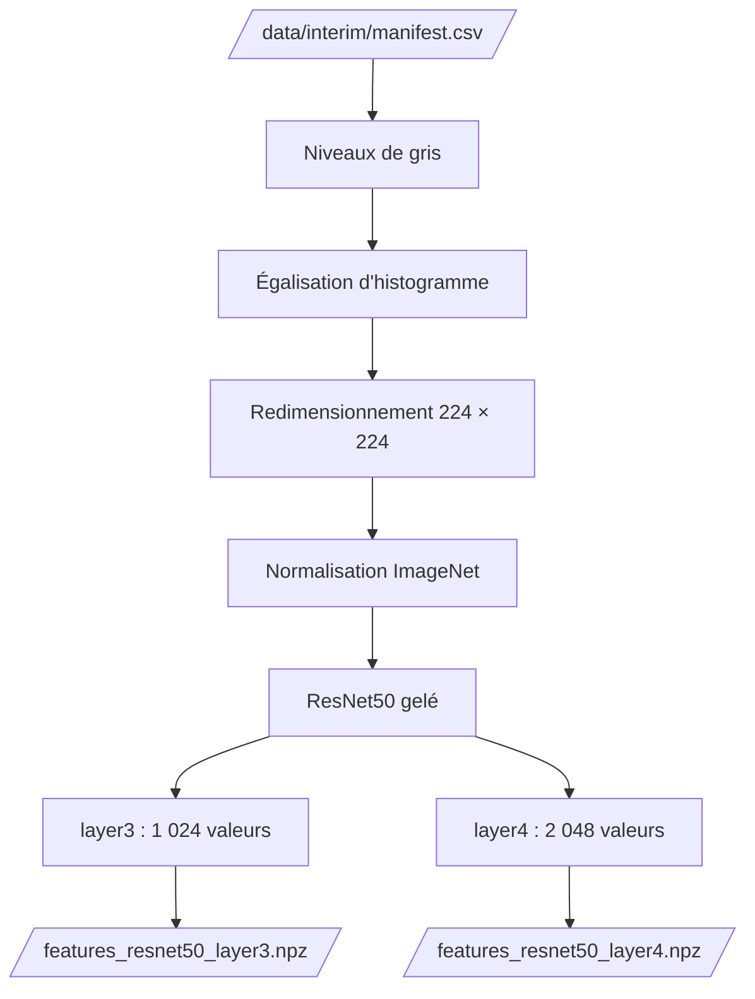

# Extraction des features

Notebook : `notebooks/03.0-kl-feature-extraction.ipynb`

L'extraction transforme chaque image du manifeste en **vecteurs de caractéristiques**, grâce à un modèle pré-entraîné, pour l'analyse non supervisée de l'étape suivante. Elle est implémentée dans `brain_mri.features`.

## Flux



## Prétraitement

| Étape | Rôle |
|---|---|
| 1. Niveaux de gris, recopiés sur 3 canaux | **Réduire les biais liés à l'image** : supprime les artefacts de couleur (10 images). Le ResNet attend 3 canaux |
| 2. Égalisation d'histogramme, en pleine résolution | **Réduire les biais liés à l'image** : gomme les différences globales de luminosité et de contraste |
| 3. Redimensionnement à 224 × 224, sans rognage | Adapter l'image au modèle, sans couper d'anatomie en bordure |
| 4. Normalisation avec les statistiques d'ImageNet | Adapter l'image à la distribution d'entraînement du modèle |


### Pourquoi les étapes 1 et 2

Trois prétraitements sont comparés sur les 98 images annotées, avec un modèle de référence (régression logistique, validation croisée stratifiée répétée, AUC moyenne ± écart-type). La colonne « descripteurs seuls » donne l'AUC d'un modèle qui ne voit que la luminosité, le contraste et la part de fond, **calculés après prétraitement** : elle mesure l'indice parasite qui reste.

| Prétraitement | `layer3` | `layer4` | Descripteurs seuls |
|---|---|---|---|
| RGB d'origine | 0,975 ± 0,038 | 0,954 ± 0,050 | 0,822 ± 0,078 |
| Niveaux de gris | 0,975 ± 0,038 | 0,955 ± 0,050 | 0,822 ± 0,078 |
| **Niveaux de gris + égalisation (retenu)** | **0,978 ± 0,040** | **0,966 ± 0,054** | **0,657 ± 0,125** |

- Sur les images d'origine, ces trois descripteurs suffisent à séparer en grande partie les classes annotées (AUC 0,82).
- Après égalisation, cet indice tombe à 0,66, alors que l'AUC des embeddings ne baisse pas. Leur signal ne vient donc pas surtout de la luminosité ni du contraste globaux.

!!! warning "Limites"
    L'égalisation ne supprime pas tout le biais : il reste la part de fond. Elle ne corrige pas non plus les différences de séquence ou de source d'acquisition, faute de métadonnées. Avec 98 images annotées, ces mesures sont indicatives.

## Extraction

- **Modèle :** ResNet50 pré-entraîné sur ImageNet, dont les couches convolutives sont **gelées** : il ne sert qu'à produire des caractéristiques.
- **Couches :** `layer3` (caractéristiques de niveau intermédiaire, 1 024 valeurs) et `layer4` (haut niveau, dernière couche convolutive, 2 048 valeurs), chacune résumée par un **average pooling global**.
- **Calcul :** GPU si disponible (CUDA ou Apple MPS), sinon CPU.

| Fonction | Rôle |
|---|---|
| `preprocess_equalized` | Prétraitement retenu (les variantes `preprocess_rgb` et `preprocess_gray` servent à la comparaison) |
| `select_device` | Choisit CUDA, MPS ou CPU |
| `load_extractor` | Charge le ResNet50 gelé qui renvoie les couches voulues |
| `extract_features` | Un vecteur par image et par couche, dans l'ordre des images |
| `save_features`, `load_features` | Écrivent et relisent les fichiers `.npz` |

La signature complète figure dans la [référence](../reference/features.md).

## Fichiers produits

Un fichier `.npz` par couche dans `data/processed/` : `features_resnet50_layer3.npz` (1 386 × 1 024) et `features_resnet50_layer4.npz` (1 386 × 2 048).

Chaque fichier contient les `image_id` **et** la matrice, dans le même ordre : l'alignement avec le manifeste ne peut pas se perdre.

```python
from brain_mri.config import PROCESSED_DATA_DIR
from brain_mri.features import load_features

image_ids, features = load_features(
    PROCESSED_DATA_DIR / "features_resnet50_layer3.npz"
)
```

## Les features portent-elles un signal ?

| Couche | Silhouette des labels (cosinus) | Écart de similarité cosinus | AUC du modèle de référence |
|---|---:|---:|---|
| `layer3` | 0,193 | 0,015 | 0,978 ± 0,040 |
| `layer4` | 0,136 | 0,056 | 0,966 ± 0,054 |

- Les vecteurs sont valides : aucune valeur non finie, aucune dimension constante.
- La projection PCA montre une structure : les `normal` se regroupent plutôt d'un côté, les `cancer` de l'autre, avec un recouvrement.
- Les deux couches ne se départagent pas : `layer3` est devant sur la silhouette et l'AUC, `layer4` sur l'écart cosinus. L'écart d'AUC est inférieur à l'écart-type. Les deux sont conservées.


## Coût de calcul

Le débit mesuré est d'environ **143 images par seconde** sur un GPU Apple (MPS), soit environ **8 heures** pour 4 millions d'images sur cette machine. Les mesures varient d'une exécution à l'autre (de 143 à 155 images par seconde sur deux exécutions). Cette estimation servira aux recommandations de passage à l'échelle.

## Lancer l'extraction

```bash
uv run python -m brain_mri.features \
    --manifest-path data/interim/manifest.csv \
    --output-dir data/processed \
    --batch-size 32
```

!!! note "Ce qui n'est pas fait ici"
    La standardisation des features dépend de la population sur laquelle on l'ajuste, donc du jeu de test à définir pour l'étape semi-supervisée. Elle se fait dans l'étape suivante. De même, le label n'est encodé (0 / 1) que pour les images annotées et seulement quand un modèle en a besoin. Les images non annotées ne reçoivent jamais de label.
