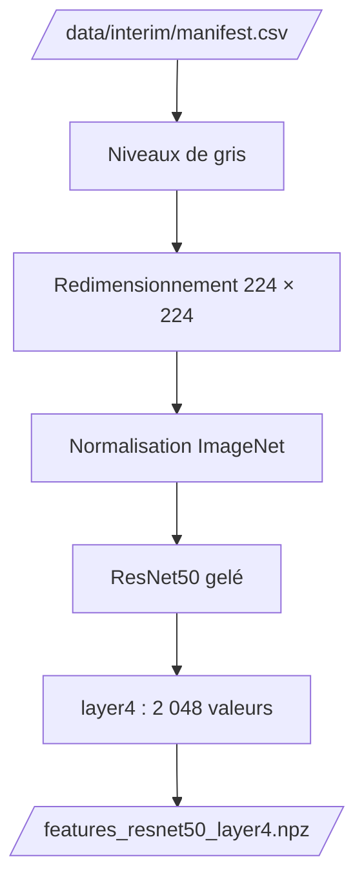

# Extraction des features

Notebook : `notebooks/02.02-kl-feature-extraction.ipynb`

L'extraction transforme chaque image du manifeste en **vecteurs de caractéristiques**, grâce à un modèle pré-entraîné, pour l'analyse non supervisée de l'étape suivante. Elle est implémentée dans `brain_mri.features`, et les cartes d'attention dans `brain_mri.attention`.

## Flux



## Prétraitement

| Étape | Rôle |
|---|---|
| 1. Niveaux de gris, recopiés sur 3 canaux | Supprime les artefacts de couleur (7 images du manifeste). Le ResNet attend 3 canaux |
| 2. Redimensionnement à 224 × 224, sans rognage | Adapter l'image au modèle, sans couper d'anatomie en bordure |
| 3. Normalisation avec les statistiques d'ImageNet | Adapter l'image à la distribution d'entraînement du modèle |


### Pourquoi les niveaux de gris

Deux prétraitements sont comparés sur les 97 images annotées, avec un modèle de référence (régression logistique, validation croisée stratifiée répétée, AUC moyenne ± écart-type).

| Prétraitement | AUC de `layer4` |
|---|---|
| RGB d'origine | 0,957 ± 0,047 |
| **Niveaux de gris (retenu)** | **0,957 ± 0,047** |

Les deux donnent les mêmes résultats : 1 284 images sur 1 291 sont déjà en niveaux de gris, donc la conversion ne change que les 7 images en couleur. Les niveaux de gris sont retenus parce qu'ils retirent les artefacts de couleur sans dégrader les caractéristiques.

## Extraction

- **Modèle :** ResNet50 pré-entraîné sur ImageNet, dont les couches convolutives sont **gelées** : il ne sert qu'à produire des caractéristiques.
- **Couche :** `layer4`, la dernière couche convolutive (caractéristiques de haut niveau, 2 048 valeurs), résumée par un **average pooling global**.
- **Calcul :** GPU si disponible (CUDA ou Apple MPS), sinon CPU.

| Fonction | Rôle |
|---|---|
| `preprocess_gray` | Prétraitement retenu (la variante `preprocess_rgb` sert à la comparaison) |
| `select_device` | Choisit CUDA, MPS ou CPU |
| `load_extractor` | Charge le ResNet50 gelé qui renvoie les couches voulues |
| `extract_features` | Un vecteur par image, dans l'ordre des images |
| `save_features`, `load_features` | Écrivent et relisent le fichier `.npz` |

La signature complète figure dans la [référence](../reference/features.md).

## Fichiers produits

Un fichier `.npz` dans `data/processed/` : `features_resnet50_layer4.npz` (1 291 × 2 048).

Chaque fichier contient les `image_id` **et** la matrice, dans le même ordre : l'alignement avec le manifeste ne peut pas se perdre.

```python
from brain_mri.config import PROCESSED_DATA_DIR
from brain_mri.features import load_features

image_ids, features = load_features(
    PROCESSED_DATA_DIR / "features_resnet50_layer4.npz"
)
```

## Les features portent-elles un signal ?

| Silhouette des labels (cosinus) | Écart de similarité cosinus | AUC du modèle de référence |
|---:|---:|---|
| 0,180 | 0,075 | 0,957 ± 0,047 |

- Les vecteurs sont valides : aucune valeur non finie, aucune dimension constante.
- La projection PCA montre une structure, avec un recouvrement : les `normal` annotées forment un groupe compact à gauche et les `cancer` sont dispersées vers la droite.
- Les valeurs de séparation sont faibles, ce qui n'a rien d'anormal avec des caractéristiques ImageNet non adaptées à l'IRM et seulement 97 images annotées. Le modèle de référence atteint une AUC de 0,957 : les caractéristiques portent un signal.


## Cartes d'activation et d'attention

Deux regards sur ce que voit le ResNet50, **sans utiliser les labels ni le clustering**. Le but n'est pas d'interpréter les images médicalement, mais de vérifier que le réseau réagit à des structures visibles. Elles se calculent avec le ResNet50 **complet**, tête de classification comprise ; l'extraction des features n'est pas modifiée.

**Canaux les plus actifs de `layer4`.** Pour chaque image, on affiche les 16 canaux dont la carte moyenne est la plus élevée. Ils forment surtout des taches larges et lisses centrées sur l'intérieur de la tête. Quelques-uns ont la forme d'un anneau : ils s'activent sur les bords de l'image et restent éteints au centre. Cinq canaux (n° 73, 739, 762, 1194 et 1771) figurent parmi les 16 plus actifs des quatre images, `cancer` comme `normal` : ils réagissent à la structure générale d'une IRM de tête plutôt qu'à une classe.


**Grad-CAM.** Les cartes de `layer4` sont pondérées par le gradient du score de la classe prédite, seules les contributions positives sont gardées, et la carte est agrandie de 7 × 7 à 224 × 224 par interpolation bilinéaire : elle reste grossière.


Les zones chaudes sont surtout de larges zones au centre de la tête. Sur deux coupes `cancer`, elles se placent au bord de l'image ou en dehors du cerveau, et elles ne se superposent pas systématiquement à la lésion visible.

!!! warning "Lecture des cartes"
    La classe prédite est une classe d'**ImageNet** (objets et animaux du quotidien : `thimble`, `chiton`, `buckle`, `lemon`, `bolo tie`...), sans aucun sens médical ; ses scores sont faibles (de 0,065 à 0,548, la plupart sous 0,16). Une carte se lit comme « les zones qui comptent pour le réseau », **pas comme un indice de cancer**.

## Coût de calcul

Le débit mesuré est d'environ **166 images par seconde** sur un GPU Apple (MPS), soit environ **7 heures** pour 4 millions d'images sur cette machine. Il varie d'une exécution à l'autre. Cette estimation servira aux recommandations de passage à l'échelle.

## Lancer l'extraction

```bash
make features
```

```bash
uv run python -m brain_mri.features \
    --manifest-path data/interim/manifest.csv \
    --output-dir data/processed \
    --batch-size 32
```

!!! note "Ce qui n'est pas fait ici"
    La standardisation des features dépend de la population sur laquelle on l'ajuste, donc du jeu de test à définir. Elle se fait à l'étape suivante, une fois les jeux réservés : voir [Analyse non supervisée](analyse-non-supervisee.md). De même, le label n'est encodé (0 / 1) que pour les images annotées et seulement quand un modèle en a besoin. Les images non annotées ne reçoivent jamais de label.
