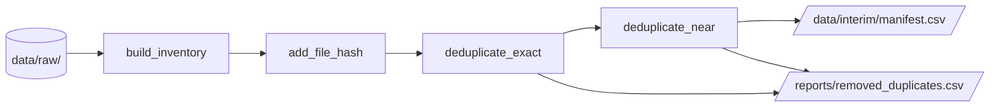

# Préparation

La préparation transforme `data/raw/` en un **manifeste dédupliqué** et un **rapport des suppressions**, sans jamais modifier les images. Elle est implémentée dans `brain_mri.dataset` et se lance avec `make data`.

## Flux



## Fonctions

| Fonction | Rôle |
|---|---|
| `build_inventory` | Une ligne par image : identifiant, chemin, sous-ensemble, label, taille |
| `add_file_hash` | Ajoute l'empreinte SHA-256 de chaque fichier |
| `deduplicate_exact` | Garde une copie par contenu binaire identique |
| `find_near_duplicate_pairs` | Repère les paires dont les miniatures sont quasi identiques |
| `deduplicate_near` | Retire un membre de chaque paire de quasi-doublons |
| `deduplicate` | Enchaîne les deux déduplications et renvoie le manifeste et le rapport |
| `write_manifest`, `read_manifest` | Écrivent et relisent le manifeste avec des chemins relatifs |

La signature complète de chaque fonction figure dans la [référence](../reference/dataset.md).

## Fichiers produits

### Manifeste : `data/interim/manifest.csv`

Une ligne par image conservée.

| Colonne | Contenu |
|---|---|
| `image_id` | Nom du fichier sans extension |
| `filepath` | Chemin **relatif à `data/raw/`**, en séparateurs POSIX |
| `subset` | `cancer`, `normal` ou `sans_label` |
| `label` | `cancer`, `normal`, ou vide si non annoté |
| `is_labeled` | `True` si l'image est annotée |
| `file_size_bytes` | Taille du fichier |
| `sha256` | Empreinte du contenu |

Les chemins relatifs rendent le manifeste portable : `read_manifest` les résout par rapport à `RAW_DATA_DIR`, ou à un autre `raw_dir` si les données ont été déplacées.

### Rapport : `reports/removed_duplicates.csv`

Une ligne par image retirée.

| Colonne | Contenu |
|---|---|
| `image_id`, `subset` | L'image retirée |
| `kept_image_id`, `kept_subset` | L'image conservée à sa place |
| `reason` | `exact` ou `near` |
| `distance` | Distance entre miniatures (0 pour un doublon exact) |

!!! note "Chaînes de suppression"
    Une image conservée à une étape peut être retirée à la suivante. Il faut alors suivre la chaîne `kept_image_id` jusqu'à une image présente dans le manifeste.

## Résultat

| | Images |
|---|---:|
| Brut | 1 506 |
| Retirées (doublons exacts) | 96 |
| Retirées (quasi-doublons) | 23 |
| **Manifeste** | **1 387** |

## Options de la commande

```bash
uv run python -m brain_mri.dataset \
    --raw-dir data/raw \
    --output-path data/interim/manifest.csv \
    --report-path reports/removed_duplicates.csv \
    --near-duplicate-threshold 0.15
```
