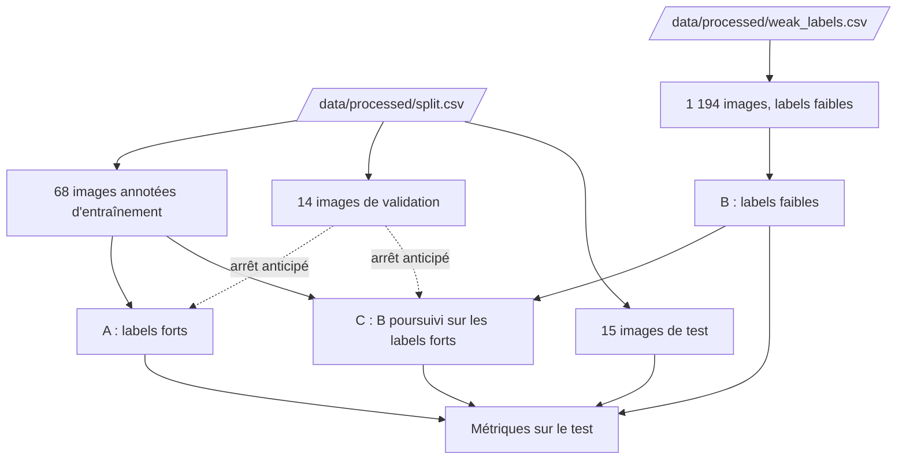

# Méthode semi-supervisée

Notebook : `notebooks/03.02-kl-semi-supervised.ipynb`

Les labels faibles de [l'analyse non supervisée](analyse-non-supervisee.md) permettent d'entraîner un CNN sur des centaines d'images non annotées. Cette page compare un CNN entraîné **d'abord sur les labels faibles, puis sur les labels forts** à un CNN entraîné **sur les labels forts seuls**, sur les mêmes images de test. Le code d'entraînement est dans `brain_mri.modeling.train`.

## Flux

## Les trois modèles

| Modèle | Entraînement | Images d'entraînement |
|---|---|---|
| **A**, supervisé | labels forts | 68 images annotées |
| **B**, faible | labels faibles | 1 194 images non annotées |
| **C**, semi-supervisé | labels faibles, puis labels forts | 1 194, puis 68 images |

Les trois partent du même **ResNet50 pré-entraîné sur ImageNet**, avec le même prétraitement que l'extraction des features (niveaux de gris, 224 × 224, normalisation d'ImageNet). Toutes les couches sont gelées, sauf `layer4` et la couche de classification, remplacée par une couche linéaire à deux sorties : 14,97 millions de paramètres entraînables sur 23,51 millions (63,7 %). Le modèle C **poursuit** l'entraînement de B. Le jeu de test (15 images) n'est lu qu'une fois par modèle.

### Réglages, fixés d'avance et jamais ajustés

| Réglage | Valeur |
|---|---|
| Optimiseur | Adam, taux d'apprentissage de 1e-4 |
| Taille des lots | 16 images |
| Phase sur les labels faibles | 10 époques fixes, sans arrêt anticipé ; lots tirés équilibrés entre `cancer` et `normal` |
| Phase sur les labels forts | 30 époques au plus, arrêt après 5 époques sans baisse de la perte de validation, meilleure époque conservée |
| Augmentation (entraînement) | retournement horizontal, rotation jusqu'à 15°, translation de 5 %, zoom de 5 % |
| Graine | 42, une seule |

La validation (14 images) ne sert qu'à l'arrêt anticipé de A et de C. Pendant la phase sur les labels faibles, elle est seulement **mesurée** à chaque époque, pour tracer les courbes. Le test ne contient que 15 images : chercher de bons réglages sur si peu d'images reviendrait à les ajuster sur le test.

## Métriques

L'erreur la plus grave est un `cancer` non détecté (faux négatif). La métrique principale est donc le **rappel de la classe `cancer`**. Les autres mesures complètent la lecture : la **précision** de `cancer`, le **F1 macro** (moyenne des F1 des deux classes), l'**exactitude**, la **matrice de confusion** et le rapport de classification. Elles sont calculées au seuil de 0,5 : une image reçoit la classe la plus probable. Elles sont implémentées par `classification_scores`.

## Résultats

| Test (15 images) | Rappel `cancer` | Précision `cancer` | F1 macro | Exactitude |
|---|---:|---:|---:|---:|
| **A**, labels forts | 0,750 | 1,000 | 0,866 | 0,867 |
| **B**, labels faibles | 0,500 | 1,000 | 0,722 | 0,733 |
| **C**, faibles puis forts | 0,875 | 1,000 | 0,933 | 0,933 |

| Validation (14 images) | Rappel `cancer` | Précision `cancer` | F1 macro | Exactitude |
|---|---:|---:|---:|---:|
| **A**, labels forts | 1,000 | 0,875 | 0,928 | 0,929 |
| **B**, labels faibles | 0,571 | 0,800 | 0,708 | 0,714 |
| **C**, faibles puis forts | 0,857 | 0,857 | 0,857 | 0,857 |

Sur le test, C détecte 7 cancers sur 8 (un raté), A 6 sur 8 (deux ratés) et B 4 sur 8. Aucun des trois ne fait de fausse alerte. Sur la validation, c'est A qui fait un peu mieux que C (rappel de 1,00 contre 0,86), d'une image aussi.

### Courbes d'apprentissage

- **A** : la perte d'entraînement tombe de 0,68 à 0,02. La perte de validation baisse jusqu'à 0,30 à l'époque 11 (conservée), puis remonte à 0,42 ; l'entraînement s'arrête à l'époque 16.
- **B** : la perte d'entraînement baisse de 0,48 à 0,20, mais la perte de validation, mesurée sur les labels forts, **monte** de 0,71 à environ 1,7 à l'époque 8, puis 1,18 à la fin. Le rappel de validation reste entre 0,57 et 0,71 : le réseau apprend les labels faibles sans apprendre à détecter les cancers annotés.
- **C** : la perte de validation, qui valait 1,18 à la fin de B, vaut 1,00 après la première époque, puis descend à 0,69 à l'époque 3 de la phase (conservée), **contre 0,30 pour A**.

## Lecture

- **C fait un peu mieux que A sur le test, A un peu mieux que C sur la validation.** Chaque écart tient à une image : il est dans le sens attendu d'une approche semi-supervisée, mais trop petit pour être démontré avec 15 images.
- **Les labels faibles seuls ne suffisent pas** : B est le moins bon des trois sur les deux jeux.
- **La phase sur les labels forts répare B** sans atteindre la perte de A.

!!! warning "Limites"
    - **Test de 15 images** (8 `cancer`, 7 `normal`) : un cancer raté représente 12,5 points de rappel.
    - **Labels faibles de qualité limitée** : l'exactitude sur les images annotées jamais vues est de 0,60 à 0,71 (voir [Analyse non supervisée](analyse-non-supervisee.md)), et les clusters suivent en partie le plan de coupe. Le réseau apprend ces labels, pas la pathologie.
    - **Information déjà contenue dans les features** : les labels faibles viennent des mêmes features ResNet50 que celles du CNN, la phase faible peut donc se contenter de reproduire la partition de K-Means.
    - **Ordre imposé par le protocole** : la phase la moins fiable vient en premier, et la phase fiable doit la rattraper.
    - **Un seul entraînement par modèle** et un seul découpage : les résultats dépendent de la graine (voir [Expérimentations](semi-supervise-experiences.md), qui répète les entraînements), et des images très proches peuvent se trouver de part et d'autre du découpage.

## Suivi des expériences

Chaque modèle (A, B et C) est un run MLflow : ses réglages, ses jeux d'entraînement, de validation et de test, ses métriques, la perte et les mesures de validation de chaque époque, la figure des courbes et le modèle lui-même. Le modèle est enregistré avec un exemple d'entrée de deux images (voir [Suivi des expériences](../reference/tracking.md)).

## Fichiers produits

Les figures de `reports/figures/` : `augmentation.png`, `semi-courbes-apprentissage.png`, `semi-metriques-test.png` et `semi-matrices-confusion.png`. L'entraînement ne produit pas d'autre fichier de données ; il s'exécute dans le notebook.
